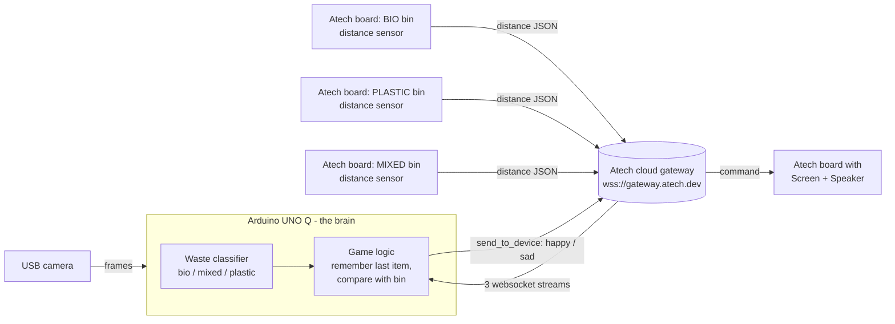

# Project context: trash-sorting game (Junction 2026)

Paste this whole file into the Arduino App Lab assistant or the Atech assistant before
asking a question, so it knows the full setup. Section 9 has ready-made questions.

## 1. What we are building
A game that teaches correct waste sorting. A player shows a piece of trash to a camera,
then drops it into one of three bins (`bio`, `plastic`, `mixed`). If they chose the right
bin, a screen shows a happy face and a speaker plays a happy sound. If not, a sad face and
a sad sound. Deadline: Sunday 10:00. Tracks: Arduino (edge AI on UNO Q) and Atech.

## 2. Hardware we have
**Arduino kit**
- Arduino UNO Q (2 GB RAM, 16 GB storage). Linux (Debian) on a Qualcomm QRB2210 processor
  plus an STM32 microcontroller. Has Wi-Fi. Has an 8x13 LED matrix on the board.
- USB camera, USB-C hub (8 in 1), 45 W USB-C power supply
- Modulino Buzzer, Modulino Knob, Modulino Thermo (Qwiic connectors) - currently unused

**Atech kits** (ESP32-based snap-together modules, firmware generated on atech.dev)
- 14-port motherboards with Wi-Fi and Bluetooth (we use 3, one above each bin)
- Per kit: Screen, Speaker, Knob, Microphone, Distance sensor, Orientation sensor,
  Temp & humidity sensor, 3x Light grid, 3x Button, 4x DC motor, 2x USB-C

## 3. Architecture

- The three Atech boards do not know about each other. Each is its own project/folder on
  atech.dev and has its own device ID.
- The UNO Q is the only coordinator. It needs internet access (Wi-Fi) because all Atech
  traffic goes through Atech's cloud gateway.
- The feedback board (screen + speaker) can be one of the three bin boards or a fourth one.

## 4. Data flow, step by step
1. Player holds an item in front of the USB camera.
2. The UNO Q classifies frames continuously. When the same class wins for about 1 second
   with confidence >= 0.7, the UNO Q stores it as the "current item" (valid ~15 seconds).
3. Player drops the item into a bin. That bin's distance sensor reading falls below a
   threshold, which counts as a "drop event" for that bin.
4. The UNO Q receives the reading over the websocket, maps the device to its bin type and
   compares: `current item == bin type`?
5. The UNO Q sends a command to the feedback board: `happy` or `sad` (optionally with the
   correct bin name). The board shows the face and plays the sound.
6. The UNO Q clears the current item and ignores further drop events for ~2 seconds.

Edge cases the logic must handle: a drop event with no current item (ignore, or show
"show me the item first"); a hand passing over two bins; the camera seeing no item.

## 5. Atech interface (what we know)
- Websocket per device: `wss://gateway.atech.dev/ws/live/<DEVICE_ID>`
- Message we receive from a bin board:
  ```json
  {"type":"distance","payload":{"board":"AA:BB:CC:DD:EE:FF","seq":21226,"t_ms":2130479,"min_mm":385}}
  ```
  `board` is the board's MAC address, `min_mm` the smallest distance seen, in millimetres.
- Message we send to a device:
  ```json
  {"type":"send_to_device","device_id":"<DEVICE_ID>","payload":{"action":"status","value":""}}
  ```
- Minimal Python client (works on a laptop):
  ```python
  # pip install websockets
  import asyncio, json, websockets
  ID = "<DEVICE_ID>"
  URL = f"wss://gateway.atech.dev/ws/live/{ID}"

  async def main():
      async with websockets.connect(URL) as ws:
          await ws.send(json.dumps({"type": "send_to_device", "device_id": ID,
              "payload": {"action": "status", "value": ""}}))
          async for raw in ws:
              print(raw)

  asyncio.run(main())
  ```
- Device IDs are kept out of this repo (it becomes public). Store them in
  `config.local.json`, which is git-ignored:
  ```json
  {"bins": {"<DEVICE_ID_1>": "bio", "<DEVICE_ID_2>": "plastic", "<DEVICE_ID_3>": "mixed"},
   "feedback_device": "<DEVICE_ID_x>", "drop_threshold_mm": 150}
  ```

## 6. The AI model
- Trained in Edge Impulse (project `junction-waste-sorting`), image classification,
  MobileNetV2 0.5, input 160x160 RGB, transfer learning.
- Output classes, in this order: `bio`, `mixed`, `plastic`. A `nothing` class (no item in
  view) is planned but not trained yet, so today the model always names one of the three.
- Accuracy: 87% on 302 held-out test images. Tuned on our own demo items.
- Files in this repo: `model/exported/waste_float32.tflite` (use this one),
  `waste_int8.tflite`, `labels.txt`.
- Edge Impulse can also build an "Arduino UNO Q" deployment: a `.eim` file (Linux program
  implementing the Edge Impulse Linux protocol). Estimated 17 ms per image on the UNO Q.

## 7. The UNO Q app (to be built in Arduino App Lab)
One app, Python side only unless we use the LED matrix:
- Camera loop: grab frame from the USB camera, run the classifier, update "current item".
- Atech loop: three websocket connections (one per bin board), detect drop events.
- Decision: compare and send `happy` / `sad` to the feedback board.
- Optional: mirror the face on the UNO Q's LED matrix (needs the sketch side + Bridge),
  small web dashboard with score.

Python needs: `websockets` (or similar), camera access, the model runtime.

## 8. Atech firmware we need
- Bin boards (x3): read the distance sensor, publish the `distance` message a few times
  per second (already working).
- Feedback board: handle `payload.action` = `happy` / `sad` (and maybe `idle`,
  `unsure`); draw the face on the Screen and play a melody on the Speaker.

## 9. Open questions for the specialised assistants
**Ask the Arduino App Lab assistant**
1. How do I use a custom Edge Impulse image classification model in an App Lab app on the
   UNO Q? I have a `.eim` built for "Arduino UNO Q" and a float32 `.tflite` (160x160 RGB,
   3 classes). Which brick do I use and where do I put the model file?
2. How does my app's Python code read frames from the USB camera and get the
   classification result (label + confidence) for each frame?
3. How do I add Python packages such as `websockets` to an App Lab app?
4. Can the Python side open outbound websocket connections to the internet
   (`wss://gateway.atech.dev/...`) while also running the camera classification? Is asyncio
   or threading the recommended way to run both?
5. How do I make the app start automatically when the board powers on, without a laptop?
6. How do I show a simple smiley / sad face on the UNO Q LED matrix from Python (Bridge)?

**Ask the Atech assistant**
1. Does `wss://gateway.atech.dev/ws/live/<DEVICE_ID>` need any authentication? Can a
   third-party client (a Linux board running Python) connect from any network?
2. Can one client listen to several devices at once, or do I open one websocket per device?
3. What is the full message schema coming from a device, and how often are `distance`
   messages sent? What exactly does `min_mm` cover (time window)?
4. How do I make the firmware react to a custom command, e.g.
   `{"action":"happy"}` -> draw a smiley on the Screen module and play a short melody on
   the Speaker module? What can the Screen draw (text, shapes, bitmaps)?
5. What is the typical delay from sensor reading to websocket message, and from
   `send_to_device` to the board reacting?
6. Is there a way to talk to the board directly on the local network (HTTP or websocket on
   the ESP32) as a fallback if the internet connection is poor?
7. Best way to detect "something was dropped into the bin" with the distance sensor
   mounted above the bin opening?
